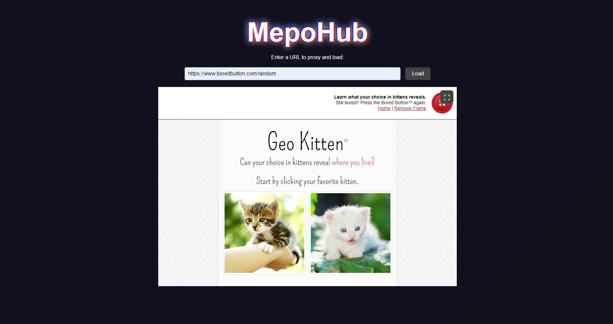
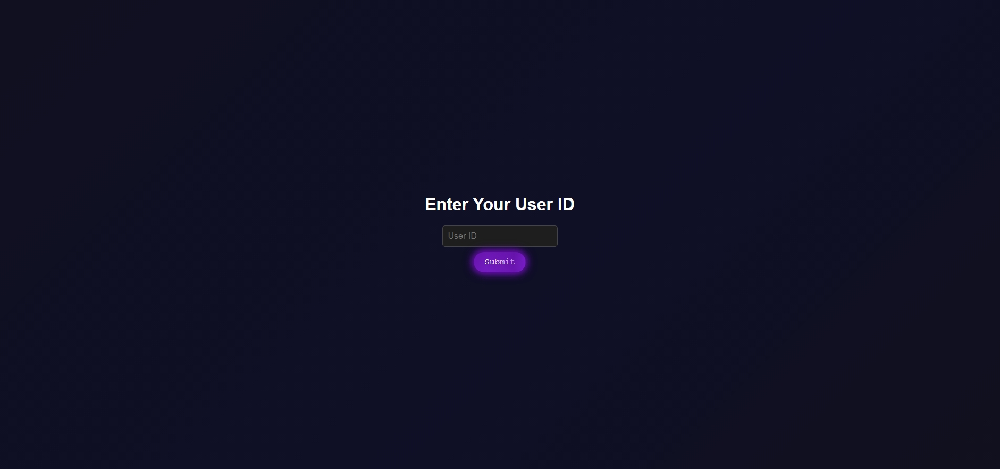

**Mepo Hub** is an unlocked school web proxy that allows users to bypass restrictions and access websites easily.

## Features

- 🔹 **Custom-built proxy** optimized for speed and accessibility
- 🔹 **Bypasses restrictions** at school and other networks
- 🔹 **Full screen** ability on website
- 🔹 **User-friendly with a simple id system that can be easily modified and redeployed to create your own links**
- 🔹 **Appealing effects** with wave dark blue enchanted look
- 🔹 **Big LoveForLearning website disguse** mostly for jokes (built but to be integrated)

## 📸 Screenshots

<p align="center">
  
</p>
<p align="center">
  
</p>

## 🛠 Installation

```bash
# Clone the repository
git clone https://github.com/Mepoify/proxy.git
cd (path)

# Install dependencies
npm install

# Start the proxy server
node server.js
```

> **Note:** Ensure you have [Node.js](https://nodejs.org/) installed before running the server.

## 🌍 Usage

If you want to test Mepo Hub locally, follow the installation steps above. However, if you just want to access it without any complications, you can use the live versions:

🔗 **[Project Website on Vercel](https://proxy-yaseen-tahas-projects.vercel.app)**  
🔗 **[Project Website on Railway](https://proxy-production-7396.up.railway.app)**  

Login password: **mepomin**

> **Note:** I am well aware that you can bypass the password by going to `oneofareurls.app/index.html` directly this will be fixed later.

## ⚠️ Known Issues

| Issue | Status |
|-------|--------|
| ❌ Google, YouTube and other bigger websites block requests | Needs better authentication and security |
| ❌ You can bypass the password system by going to `oneofareurls.app/index.html | Simple but fixed soon |

> Smaller websites work fine

## 🛠 Roadmap
- 🔜 Switch proxy engine to UV (cause making my own is getting out of hand and im realizing theres nothing to gain from making my own)
- 🔜 Fix /index.html bypass issue
- 🔜 v1.00 launches

## 📜 License
This project is licensed under the the Unlicense - see the [LICENSE](LICENSE) file for details.

## 📩 Contact
**Email**: t_yaseen@icloud.com

**GitHub**: [Mepoify](https://github.com/Mepoify)

